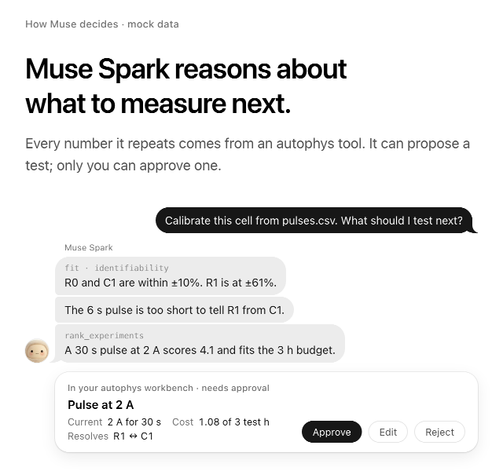
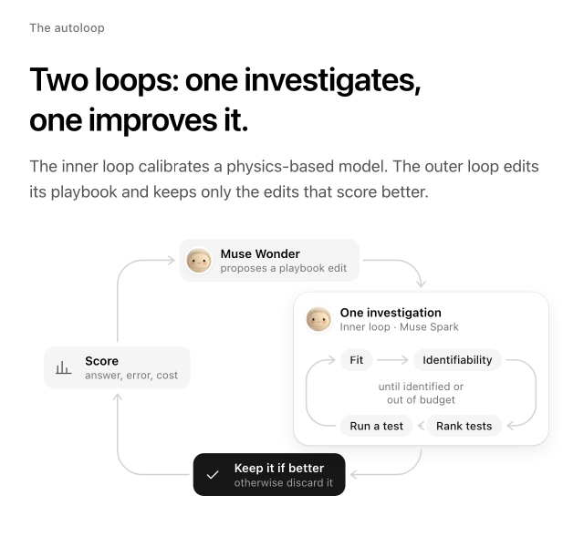
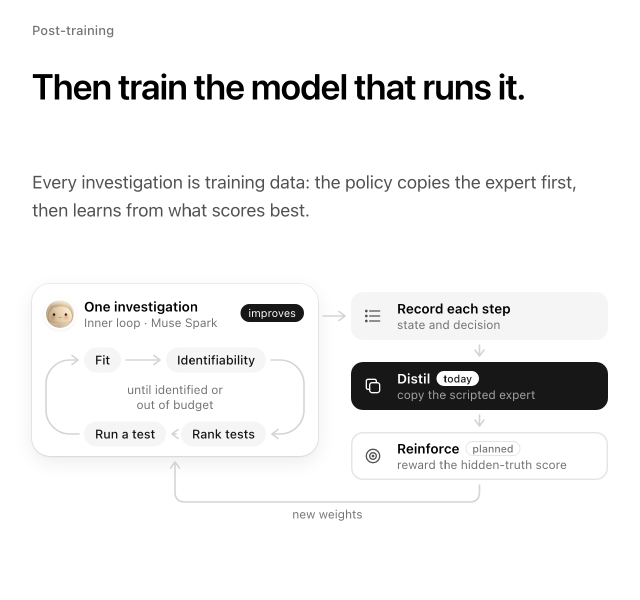

# AutoPhys

**Fit your model. Find out what to test next.**

**Live site: [autophys.lona.so](https://autophys.lona.so)** ·
[Open the workbench](https://autophys.lona.so/app)

AutoPhys helps engineers and researchers fit physical models to measurements,
see what remains uncertain, and choose the next experiment. Agents analyze the
results and propose tests. You steer the investigation and approve what gets run.



*Illustrative conversation from the live site with mock data.*

## A good fit is only the beginning

In the bundled synthetic battery example, a short test fits the voltage curve
well while leaving resistance R1 and capacitance C1 hard to distinguish.
AutoPhys flags the ambiguity and recommends a test to separate them. Run the
test, attach the measurements, and refit before checking predictions against
held-out data.

## Install a release

Each [release](https://github.com/yuzuquats/autophys/releases) has an archive
for Linux x86_64 (`x86_64-unknown-linux-gnu`, glibc 2.39 or newer), Linux
ARM64 (`aarch64-unknown-linux-gnu`, glibc 2.28 or newer), Apple silicon macOS
(`aarch64-apple-darwin`) and Intel macOS (`x86_64-apple-darwin`).
It holds one `autophys` executable with the web app built in, plus the license
notices. Serving needs nothing else installed.

```sh
target=x86_64-unknown-linux-gnu      # choose the target above for your OS and CPU
curl -fLO https://github.com/yuzuquats/autophys/releases/download/v0.1.5/autophys-v0.1.5-$target.tar.gz
tar -xzf autophys-v0.1.5-$target.tar.gz
install -m 755 autophys-v0.1.5-$target/autophys ~/.local/bin/autophys   # or any directory on your PATH
autophys serve          # the workbench and API on http://127.0.0.1:4794
```

The macOS executable is ad-hoc signed, not notarized. A copy downloaded with a
browser is quarantined, so download with `curl` as above, or run
`xattr -d com.apple.quarantine autophys`.

To build from source instead, you need Rust:

```sh
git clone https://github.com/yuzuquats/autophys.git
cd autophys
cargo build --release --locked --bin autophys
export PATH="$PWD/target/release:$PATH"
```

## Try the battery example

You need the `autophys` command on your PATH ([installed](#install-a-release)
or built from source), Python 3.10 or newer, and Git. `autophys new` creates a
project whose SDK dependency is pinned to the commit the command was built
from. This local example needs no account or provider key.

```sh
autophys new my-cell --lang python   # the battery-fit project, with its own .venv
cd my-cell
.venv/bin/python battery_fit.py data/short.csv --out short.png
```

The curve fits, but the abbreviated parameter verdict is:

```text
R0  identified
R1  NOT identified
C1  NOT identified
```

The [end-to-end walkthrough](#run-an-experiment-end-to-end) below continues
from here: it lets the agent choose the test that separates R1 from C1. The
project's README ([source](examples/battery-fit.demo/python/README.md)) explains
the results and how to use your own cell data, import measurements from a
cycler, or choose a model-backed policy. `--lang rust` creates the same fit in
Rust, and `--example blank` an empty project; `autophys examples` lists every
template, demo and backtest. `autophys connect URL` pairs the device with a
server once.

## Run an experiment end to end

This walkthrough runs one complete investigation from the command line with a
simulated battery cell. You create a project and fit a short test. The agent
proposes the next test, you approve it, and its data is attached and refitted.
The result is then checked against data the fit never saw. It all runs
locally, with no account, server or model key.

**1. Create a project.** With `autophys` on your PATH
([install a release](#install-a-release) or build it from source), create the
project. If you already followed the battery example above, `cd` to its
`my-cell` and go on to step 2.

```sh
autophys new my-cell --lang python
cd my-cell
```

`autophys new` copies the battery-fit template and creates its Python
environment in `.venv`, with the SDK pinned to the commit the binary was built
from.

**2. List the tests the agent may propose.**

```sh
.venv/bin/python closed_loop.py tests
```

```text
quick_pulse     1 min  rest 10 s, +2 A 30 s, rest 4 s
pulse_rest     11 min  rest 10 s, +2 A 30 s, rest 600 s
pulse_ladder   17 min  rest 10 s, +1 A 30 s, rest 300 s, +2 A 30 s, rest 300 s, -1.5 A 30 s, rest 300 s
cc_discharge   15 min  rest 10 s, +1 A 900 s
check           6 min  rest 10 s, +1.5 A 60 s, rest 120 s, -1 A 60 s, rest 120 s  [held out: never fitted, only predicted]

sampled at 2 Hz; capacity 2.5 Ah, starting SOC 0.9
```

**3. Start the investigation.** `--simulate` stands in for a cycler. It
generates each test's voltage from a hidden cell (R0 = 0.025 Ω, R1 = 0.045 Ω,
C1 = 1600 F) with 2 mV of noise.

```sh
.venv/bin/python closed_loop.py start --simulate
```

```text
status: awaiting_data (proposal prop_81087db945c5 awaits approval and data)
  R0  = 0.024856 ohm  identified
  R1  = 0.050667 ohm  NOT identified
  C1  = 1644.2 F    NOT identified
  tied: R1^1 * C1^0.22
  tests run: 2 (quick_pulse, check [held out]), 7 min of cycler time

proposed next test: pulse_ladder (17 min): rest 10 s, +1 A 30 s, rest 300 s, +2 A 30 s, rest 300 s, -1.5 A 30 s, rest 300 s
  why: pulse_ladder adds the most information on the weakest direction
  proposal prop_81087db945c5 in investigation inv_7e2f4bcb369e2de9
```

The quick pulse pins R0 but only a combination of R1 and C1, so the agent
proposes the test that best separates them and stops. It never approves its
own proposal.

**4. Inspect and approve the proposal.** The investigation is recorded in a
local workbook in `~/autophys` (set `AUTOPHYS_HOME` to use another directory).
These commands print JSON. Use the IDs your `start` printed.

```sh
autophys investigations                                    # each investigation, its status and steps
autophys records inv_7e2f4bcb369e2de9 --kind proposal      # the proposal, its rationale and settings
autophys approve inv_7e2f4bcb369e2de9 prop_81087db945c5
```

`approve --settings JSON` approves an edited version of the test, and
`autophys reject INVESTIGATION PROPOSAL --reason TEXT` turns it down.

**5. Run the approved test and refit.**

```sh
.venv/bin/python closed_loop.py continue --simulate
```

```text
attached pulse_ladder (synthetic, 2001 samples)

status: validated
  R0  = 0.024944 ohm  identified
  R1  = 0.045125 ohm  identified
  C1  = 1609.9 F    identified
  tests run: 3 (quick_pulse, check [held out], pulse_ladder), 24 min of cycler time
  held-out check: chi2/N 1.04 (passed, threshold 2)

plot: loop.png
```

All three parameters are now identified, and the fit predicts the held-out
`check` test within its noise.

**6. Verify the record.**

```sh
autophys verify
```

This checks the workbook's hash chain and its projections, and reports
`"ok": true` with the number of records.

To use a real cell, run the proposed programs on your cycler and pass each
export with `--data` instead of `--simulate`. To record on a shared server and
approve in the browser, pair once with `autophys connect URL` and set
`AUTOPHYS_SERVER`. The [project README](examples/battery-fit.demo/python/README.md#5-run-the-closed-loop)
covers both, and `--policy model` hands the decisions to a language model.

## Use your own model

Built-in models cover batteries, oscillators and thermal systems. Use the
[Python SDK](sdks/python/README.md) or [Rust SDK](autophys.project.docs/content/rust-sdk.md) to supply
a model and measurements, or [connect Muse](autophys.project.docs/content/muse-plugin.md)
to the investigation tools. Model-backed agents require provider setup.

Today, AutoPhys fits supplied models and ranks catalog experiments. The
longer-term goal is to help revise the underlying physics too.

## Commands

Everything runs through the one `autophys` binary; the Python and Rust SDKs
are libraries. `autophys <command> --help` lists each command's flags.

| Start a project | |
| --- | --- |
| `autophys new DIR --lang python\|rust` | Create a project from a template (`--example battery-fit\|blank`); Python projects get a `.venv` |
| `autophys connect [URL]` | Pair this device with a server and save its key |
| `autophys whoami` | Show the account, workspace and device the key belongs to |

| Investigations | |
| --- | --- |
| `autophys projects` | List projects |
| `autophys investigations` | List investigations (`--project NAME`) |
| `autophys records INVESTIGATION` | Read an investigation's records (`--kind KIND`) |
| `autophys approve INVESTIGATION PROPOSAL` | Approve a proposed experiment (`--settings JSON` to edit it) |
| `autophys reject INVESTIGATION PROPOSAL` | Reject it (`--reason TEXT`) |
| `autophys verify` | Check workbook hash chains and projections |

These act on a collection directory, `.ap-workbook` file or server URL given with
`--target` (default `AUTOPHYS_HOME` or `~/autophys`).

| Agents and research | |
| --- | --- |
| `autophys mcp` | Serve the investigation tools to Muse Code over MCP; `--project mypkg.module:project` runs your own Python simulator |
| `autophys examples` | List the built-in templates, demos and backtests; `--check REF` validates an example folder |
| `autophys bench` | Score a policy or model on backtests offline (`--example battery#short-only`, `--policy scripted\|fake-reasoner\|reason`, `--truth drawn`); `--append FILE` collects runs and `--summary FILE` compares models |
| `autophys research` | Evaluate and improve playbook strategies (`--output-dir DIR`) |
| `autophys autoloop` | Keep researching until a stop condition, with a journal and `--resume` |
| `autophys export-trajectories SOURCE` | Export recorded reasoner decisions as JSONL |
| `autophys train dataset\|eval\|run\|runs\|loop\|loops` | Build training data, evaluate and fine-tune policies, list runs and loops ([training guide](train/sft/README.md)) |

| Server and administration | |
| --- | --- |
| `autophys serve` | Serve the workbench and API on loopback (`--addr 127.0.0.1:4794`) |
| `autophys pair list\|approve CODE\|deny CODE` | Approve devices that ran `autophys connect` |
| `autophys keys list\|revoke KEY_ID` | Manage device keys |
| `autophys users list\|add EMAIL\|set\|remove` | Manage sign-in accounts |
| `autophys workspace list\|bind\|key\|seed\|profile` | Bind accounts to collections (dry run unless `--apply`) |
| `autophys db verify` | Verify the server's collection (`--rebuild`) |
| `autophys build-web`, `autophys pack` | Build the web app and pack a single-file release ([ops](ops/README.md)) |

## The learning loop

<table>
<tr>
<td width="50%"></td>
<td width="50%"></td>
</tr>
<tr>
<td valign="top">The inner loop calibrates a physical model. The outer loop evaluates changes to the investigation playbook and keeps those that score better: <code>autophys research</code> and <code>autophys autoloop</code>, offline with the fake reasoner and the heuristic researcher.</td>
<td valign="top">Policy training is separate from fitting the physical model. The diagram shows the distillation workflow; reinforcement learning is planned. See the <a href="train/sft/README.md">training guide</a> for the current pipeline and its limits.</td>
</tr>
</table>

## Development and feedback

Start with [CONTRIBUTING.md](CONTRIBUTING.md) and the
[repository map](docs/README.md). The daemon, browser and SDKs build from this
checkout; no Lona account, fleet CLI or sibling repository is required.
Optional model providers, Muse and systemd deployment have separate setup.

Working on battery characterization? Real-cell CSVs and OCV tables, HPPC
run/rest budgets, and feedback on the R1/C1 trade-off would help ground the
examples in lab practice.

## License

Licensed under either of [Apache License, Version 2.0](LICENSE-APACHE) or
[MIT license](LICENSE-MIT) at your option; see [NOTICE](NOTICE) for the
vendored and third-party parts.
