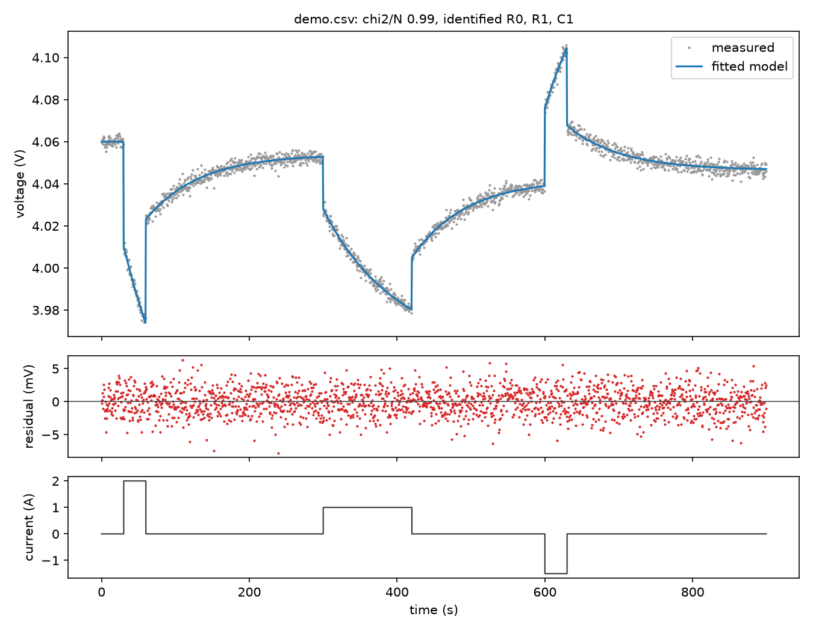
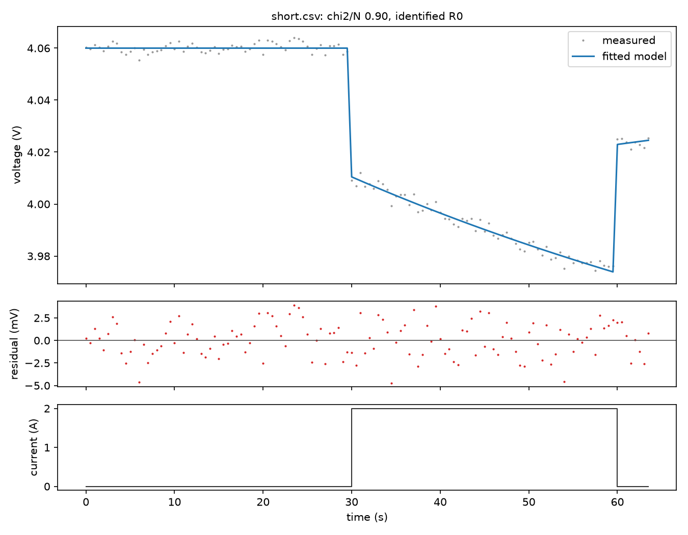

# Fit a battery cell and see which parameters your data pins down

This project was created by `autophys new --lang python --example
battery-fit`. It fits a first-order (1RC) battery model to a time / current /
voltage CSV, plots the measured and fitted voltage, and says which of R0, R1
and C1 the data determines to better than ±10%. It runs locally, with no
accounts, keys or network calls after setup. Section 5 runs the closed loop:
an agent proposes the next cycler test, a person approves it, and its data is
attached and refitted.

```
.
├── README.md          this file
├── pyproject.toml     the autophys SDK (pinned to one commit) and matplotlib
├── .venv/             the environment `autophys new` created
├── battery_fit.py     the model, fit, identifiability check and plot
├── closed_loop.py     the closed loop: propose the next test, attach its data, refit
├── .env.example       server and model settings for the closed loop; copy to .env
├── data/
│   ├── demo.csv       a made-up cell with a known answer: three pulses and rests, 2 mV noise
│   ├── short.csv      the first 64 s of demo.csv: one pulse with no rest after it
│   └── ocv_generic.csv  the default OCV table; use it as a template for your cell's own
└── expected/          what a correct run prints and plots, for comparison
    ├── demo.txt  demo.png
    └── short.txt short.png
```

The commands below use `.venv/bin/python`; after `. .venv/bin/activate`,
plain `python` works too. If you created the project with `--no-install`, set
up the environment first (Python 3.10 or newer, and git to fetch the SDK):

```sh
python3 -m venv .venv
.venv/bin/python -m pip install .
```

The `autophys` commands below assume the binary is on your PATH, from a
[release](https://github.com/yuzuquats/autophys/releases) or built from
source (or use its full path). The SDK dependency is a git URL on the public
GitHub repository, fetched over https with no credentials.

## 1. Run the demo

```sh
.venv/bin/python battery_fit.py data/demo.csv
```

It fits `data/demo.csv` and writes `fit.png`:

```
fit: chi2/N = 0.99 (converged; ~1 means the residuals match sigma)
  R0  = 0.024857 ohm       ±0.4%  identified
  R1  = 0.045448 ohm       ±0.4%  identified
  C1  = 1589.3 F         ±0.7%  identified

plot: fit.png
```

The demo cell's true values are R0 = 0.025 Ω, R1 = 0.045 Ω and C1 = 1600 F.
Compare `fit.png` with `expected/demo.png`: measured and fitted voltage on
top, residuals in mV in the middle, and current at the bottom.



## 2. See what the identifiability check adds

```sh
.venv/bin/python battery_fit.py data/short.csv --out short.png
```

```
  R0  = 0.024773 ohm       ±0.8%  identified
  R1  = 0.042943 ohm   unbounded  NOT identified
  C1  = 1556.9 F     unbounded  NOT identified
  tied: R1^1 * C1^0.28 (practical)
```

The curve still fits well (`expected/short.png`). But one pulse without the
relaxation after it can't separate R1 from C1; only a combination of them is
fixed. A good-looking fit alone would not tell you that.



## 3. Fit your own cell

```sh
.venv/bin/python battery_fit.py /path/to/my_cell.csv --sigma 0.002 \
  --capacity-ah 2.5 --soc0 0.9 --ocv /path/to/my_ocv.csv --out my_cell.png
```

| Input | What to give | Default |
| --- | --- | --- |
| CSV | a header row, then time (s, strictly increasing), current (A, **positive = discharging**) and terminal voltage (V). Any current trace works: HPPC pulses, rests, drive cycles. | n/a |
| `--columns` | your header names for time, current and voltage, comma-separated | `time,current,voltage` |
| `--sigma` | voltage noise standard deviation (V), taken from the sensor or cycler spec, **not** from the fit residual | 0.002 |
| `--capacity-ah` | cell capacity (Ah) | 2.5 |
| `--soc0` | state of charge at t = 0, from 0 to 1 | 0.9 |
| `--ocv` | `soc,voltage` CSV of your cell's open-circuit voltage, in the same format as `data/ocv_generic.csv` | the generic NMC-like table in `data/ocv_generic.csv` |
| `--out` | where to write the plot | `fit.png` |

Convert units first if your file uses ms, mA or mV, or if its sign
convention is positive for charging. The generic OCV table is only a
placeholder, and a wrong OCV curve will show up as structure in the
residuals. `python battery_fit.py --help` lists the options.

## 4. Read the result

- **chi2/N:** about 1 means the residuals match your stated noise. Well above 1
  means the model is missing something, or `--sigma` is too small. Well below 1
  means `--sigma` is too large.
- **identified:** the data pins that parameter to better than ±10%. This comes
  from a sensitivity (log-Jacobian SVD) analysis at the fit, not from how the
  curve looks.
- **NOT identified** and **tied:** the data fixes only the printed combination.
  Usually the test needs a longer rest after a pulse, or pulses at different
  currents.
- **at bounds:** the fit hit a parameter's limit. Check units, or widen the
  bounds in `make_model`.

## 5. Run the closed loop

The fit above uses data you already have. The closed loop decides which test
to run next. It starts from one short test, fits it, and finds what the data
can't determine. It then ranks the cycler tests it may propose, proposes the
most informative one, and stops until a person approves it. Once the test's
data is attached, it refits and checks the result against a held-out test that
it never fits.

```sh
.venv/bin/python closed_loop.py tests              # the programs it may propose, plus the held-out check
.venv/bin/python closed_loop.py start --simulate   # fit quick_pulse; ends with a proposal
autophys approve INVESTIGATION PROPOSAL            # as printed by start; or approve it in the browser
.venv/bin/python closed_loop.py continue --simulate   # attach the test's data, refit, report, write loop.png
```

`--simulate` stands in for a cycler. It generates each test's voltage from a
hidden demo cell (R0 = 0.025 Ω, R1 = 0.045 Ω, C1 = 1600 F) plus 2 mV noise, and
records the data as `synthetic`. The start ends like this:

```
status: awaiting_data (proposal prop_… awaits approval and data)
  R0  = 0.024856 ohm  identified
  R1  = 0.050667 ohm  NOT identified
  C1  = 1644.2 F    NOT identified
  tied: R1^1 * C1^0.22
  tests run: 2 (quick_pulse, check [held out]), 7 min of cycler time

proposed next test: pulse_ladder (17 min): rest 10 s, +1 A 30 s, rest 300 s, +2 A 30 s, rest 300 s, -1.5 A 30 s, rest 300 s
  approve it in …, or with `autophys approve inv_… prop_…`
```

and the continue like this:

```
status: validated
  R0  = 0.024944 ohm  identified
  R1  = 0.045125 ohm  identified
  C1  = 1609.9 F    identified
  tests run: 3 (quick_pulse, check [held out], pulse_ladder), 24 min of cycler time
  held-out check: chi2/N 1.04 (passed, threshold 2)
```

The proposal is approved by a person, never by the loop itself: in the
browser, or with the `autophys` command line tool (`autophys approve`, or
`autophys reject` with a `--reason`). `autophys investigations` lists the
investigations and where each stands, and `autophys records INVESTIGATION
--kind proposal` shows its proposals. Without `--target`, these read the same
local workbook in `~/autophys` that the loop writes.

**With a real cell**, run the programs listed by `closed_loop.py tests` on
the cycler at 2 Hz, starting at 90% SOC, and export each as a
`time,current,voltage` CSV. The script checks that the current matches the
program, then resamples the voltage onto the program's time grid.

```sh
.venv/bin/python closed_loop.py start --data quick_pulse.csv --validation check.csv --sigma 0.002
.venv/bin/python closed_loop.py continue --data pulse_ladder.csv    # after approving and running the proposed test
```

The cell's capacity, starting SOC and OCV curve are fixed in `closed_loop.py`
(`CELL` and the generic OCV table). Edit them for your cell.

**Who decides each step.** `--policy scripted`, the default, is autophys's
built-in strategy: fit, check identifiability, and propose the top-ranked test.
It needs no network. `--policy model` hands each decision to a language model
that reads the autophys playbook; set it up in `.env` (see `.env.example`, for
example a Baseten deployment). The fit, identifiability check and ranking run
on this machine either way, and the guardrail rechecks any "identified" claim
before the result is recorded.

**Where it's recorded.** Without `AUTOPHYS_SERVER`, investigations go to a
local workbook in `~/autophys`. To record them on a shared server, where
proposals are approved in the browser:

```sh
autophys connect https://your-server      # prints a code; the server's operator approves it
cp .env.example .env                      # set AUTOPHYS_SERVER to the same URL
.venv/bin/python closed_loop.py start --simulate
.venv/bin/python closed_loop.py continue --simulate --wait    # waits for the approval in the browser
```

`autophys whoami` shows the account the saved device key belongs to. The
current investigation's ID is kept in `.agent-state.json` in this folder.

## The model

```
V = OCV(SOC) − V1 − I·R0
dV1/dt = −V1/(R1·C1) + I/C1
dSOC/dt = −I/(3600·Q)
```

Q, the starting SOC and the OCV curve are known; R0, R1 and C1 are fitted
within 1 mΩ to 0.5 Ω and 10 F to 100 kF. The current is held constant
between samples, and the RC update is exact for that. All of it is
`make_model` in `battery_fit.py`, about 20 lines. A 2RC model or a
temperature-dependent OCV is an edit there: the function returns
`{"t": t, "v": volts}` for given parameters.

## Regenerate the bundled files

```sh
.venv/bin/python battery_fit.py --demo data/demo.csv --out expected/demo.png > expected/demo.txt
awk -F, 'NR==1 || $1<64' data/demo.csv > data/short.csv
.venv/bin/python battery_fit.py data/short.csv --out expected/short.png > expected/short.txt
```

The demo uses a fixed random seed, so this reproduces the files exactly.
