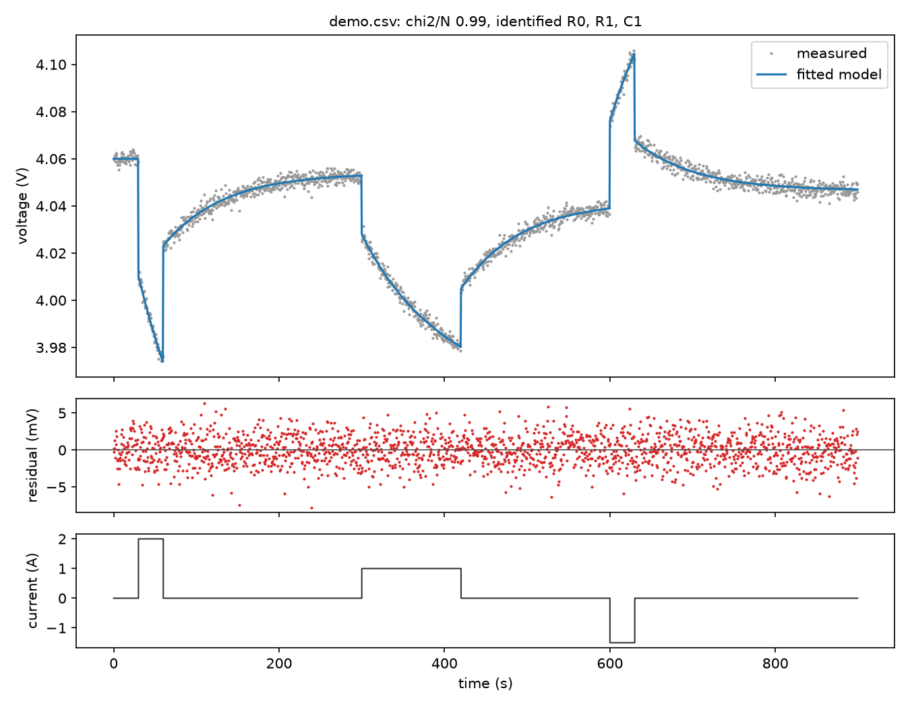
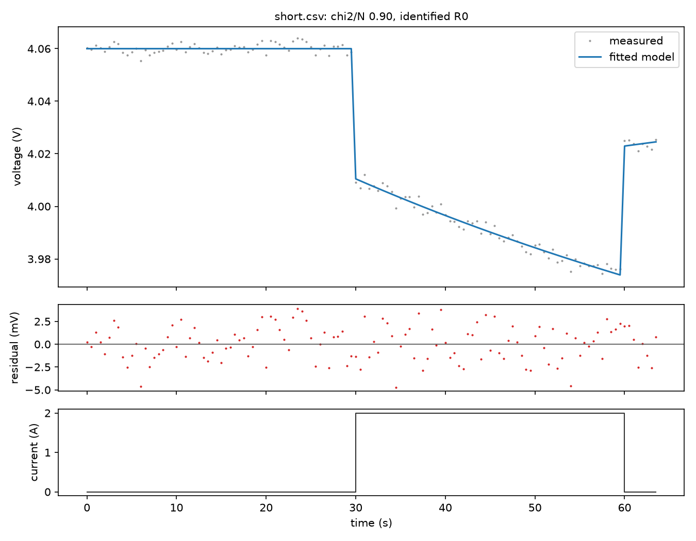

# Fit a battery cell and see which parameters your data pins down

Everything needed to run this is in this folder. It fits a first-order
(1RC) battery model to a time / current / voltage CSV, plots the measured and
fitted voltage, and says which of R0, R1 and C1 the data determines to better
than ±10%. It runs locally, with no accounts, keys or network calls after
setup.

```
battery_fit/
├── README.md          this file
├── run.sh             one-step setup and run
├── battery_fit.py     the model, fit, identifiability check and plot
├── data/
│   ├── demo.csv       a made-up cell with a known answer: three pulses and rests, 2 mV noise
│   ├── short.csv      the first 64 s of demo.csv: one pulse with no rest after it
│   └── ocv_generic.csv  the default OCV table; use it as a template for your cell's own
└── expected/          what a correct run prints and plots, for comparison
    ├── demo.txt  demo.png
    └── short.txt short.png
```

## 1. Run the demo

You need git and Python 3.10 or newer. From the repo root:

```sh
cd examples/battery_fit
./run.sh
```

The first run creates `.venv/` here and installs the autophys SDK (from
`../../sdks/python`, needing numpy and scipy) and matplotlib. Then it fits
`data/demo.csv` and writes `fit.png`:

```
fit: chi2/N = 0.99 (converged; ~1 means the residuals match sigma)
  R0  = 0.024857 ohm       ±0.4%  identified
  R1  = 0.045448 ohm       ±0.4%  identified
  C1  = 1589.3 F         ±0.7%  identified

plot: fit.png
```

The demo cell's true values are R0 = 0.025 Ω, R1 = 0.045 Ω and C1 = 1600 F.
Compare `fit.png` with `expected/demo.png`: measured and fitted voltage on
top, residuals in mV in the middle, and current at the bottom.



## 2. See what the identifiability check adds

```sh
./run.sh data/short.csv --out short.png
```

```
  R0  = 0.024773 ohm       ±0.8%  identified
  R1  = 0.042943 ohm   unbounded  NOT identified
  C1  = 1556.9 F     unbounded  NOT identified
  tied: R1^1 * C1^0.28 (practical)
```

The curve still fits well (`expected/short.png`). But one pulse without the
relaxation after it can't separate R1 from C1; only a combination of them is
fixed. A good-looking fit alone would not tell you that.



## 3. Fit your own cell

```sh
./run.sh /path/to/my_cell.csv --sigma 0.002 --capacity-ah 2.5 --soc0 0.9 \
  --ocv /path/to/my_ocv.csv --out my_cell.png
```

| Input | What to give | Default |
| --- | --- | --- |
| CSV | a header row, then time (s, strictly increasing), current (A, **positive = discharging**) and terminal voltage (V). Any current trace works: HPPC pulses, rests, drive cycles. | n/a |
| `--columns` | your header names for time, current and voltage, comma-separated | `time,current,voltage` |
| `--sigma` | voltage noise standard deviation (V), taken from the sensor or cycler spec, **not** from the fit residual | 0.002 |
| `--capacity-ah` | cell capacity (Ah) | 2.5 |
| `--soc0` | state of charge at t = 0, from 0 to 1 | 0.9 |
| `--ocv` | `soc,voltage` CSV of your cell's open-circuit voltage, in the same format as `data/ocv_generic.csv` | the generic NMC-like table in `data/ocv_generic.csv` |
| `--out` | where to write the plot | `fit.png` |

Convert units first if your file uses ms, mA or mV, or if its sign
convention is positive for charging. The generic OCV table is only a
placeholder, and a wrong OCV curve will show up as structure in the
residuals.

You can also run the script directly with any Python environment that has the
SDK installed: `python battery_fit.py --help`.

## 4. Read the result

- **chi2/N:** about 1 means the residuals match your stated noise. Well above 1
  means the model is missing something, or `--sigma` is too small. Well below 1
  means `--sigma` is too large.
- **identified:** the data pins that parameter to better than ±10%. This comes
  from a sensitivity (log-Jacobian SVD) analysis at the fit, not from how the
  curve looks.
- **NOT identified** and **tied:** the data fixes only the printed combination.
  Usually the test needs a longer rest after a pulse, or pulses at different
  currents.
- **at bounds:** the fit hit a parameter's limit. Check units, or widen the
  bounds in `make_model`.

## The model

```
V = OCV(SOC) − V1 − I·R0
dV1/dt = −V1/(R1·C1) + I/C1
dSOC/dt = −I/(3600·Q)
```

Q, the starting SOC and the OCV curve are known; R0, R1 and C1 are fitted
within 1 mΩ to 0.5 Ω and 10 F to 100 kF. The current is held constant
between samples, and the RC update is exact for that. All of it is
`make_model` in `battery_fit.py`, about 20 lines. A 2RC model or a
temperature-dependent OCV is an edit there: the function returns
`{"t": t, "v": volts}` for given parameters.

## Regenerate the bundled files

```sh
.venv/bin/python battery_fit.py --demo data/demo.csv --out expected/demo.png > expected/demo.txt
awk -F, 'NR==1 || $1<64' data/demo.csv > data/short.csv
.venv/bin/python battery_fit.py data/short.csv --out expected/short.png > expected/short.txt
```

The demo uses a fixed random seed, so this reproduces the files exactly.
